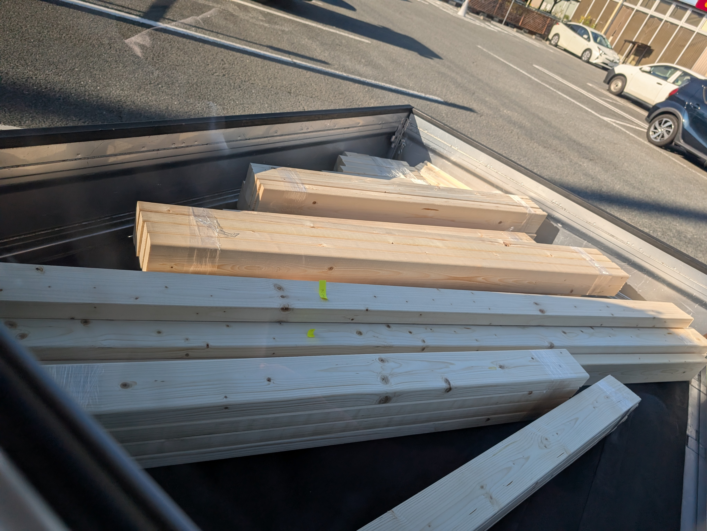
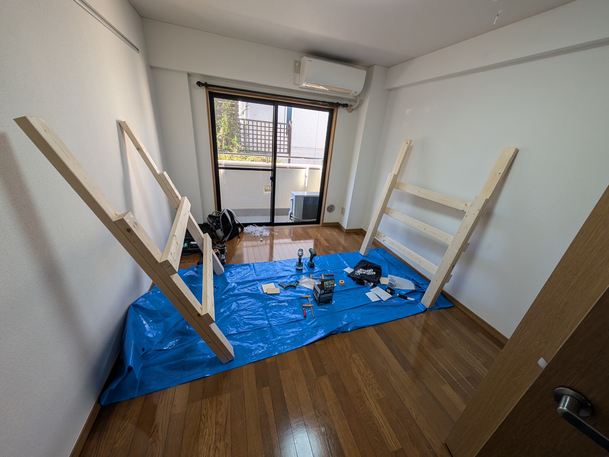
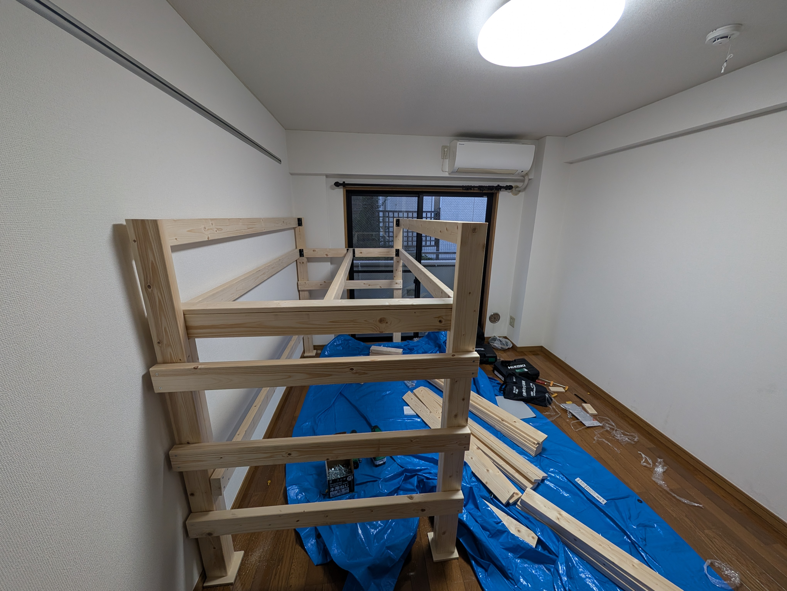
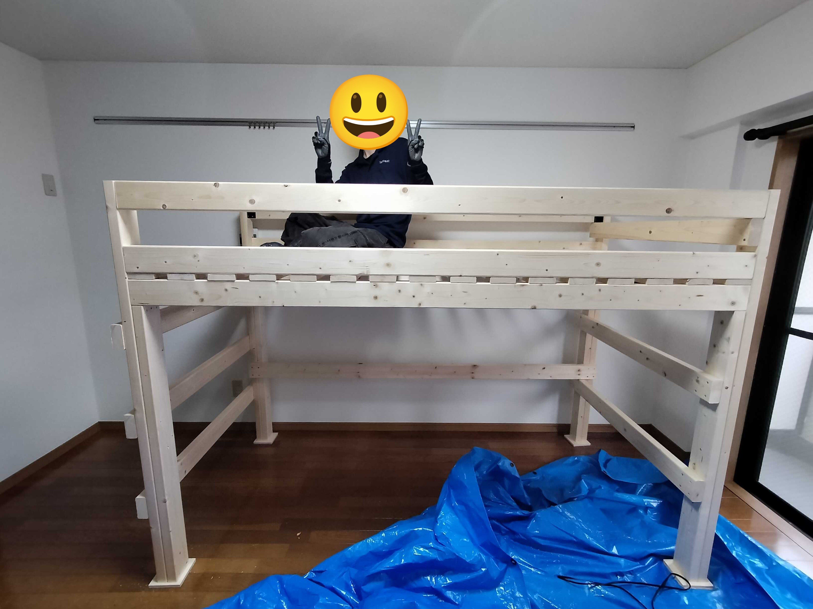
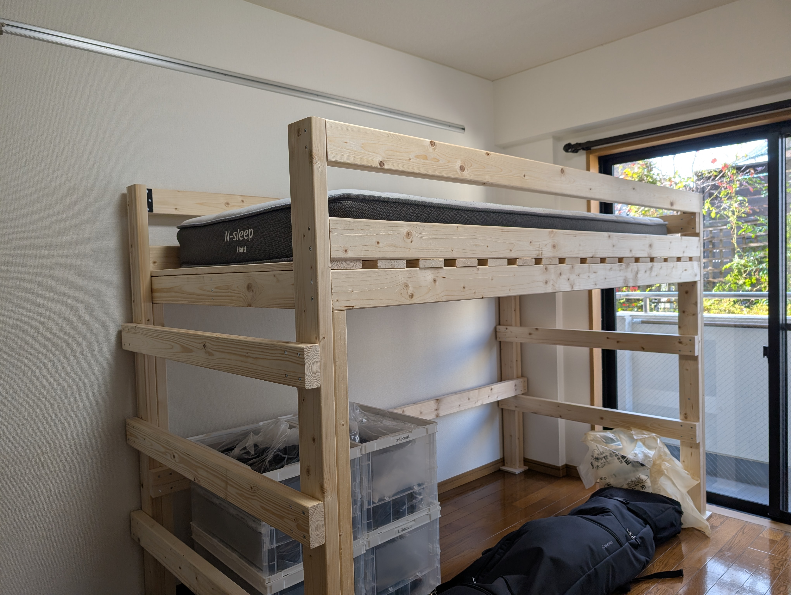

## 概要

最近大学の寮から近くの賃貸マンションに引っ越したんですが、まあ単身の学生が東京で借りられるお部屋なんて大した広さもなく、どうにか工夫してスペースを確保しないとなぁ〜と思い、ロフトベット自作を決意しました。

6畳ワンルームだと、ベッドとデスク置いたら部屋の半分が埋まるくらいの感覚で、とにかくベッドの面積が大きく、普通のベッドだとその上の空間が無駄になってしまうということで、ベッド下に収納空間を作るために今回はロフトベットにします。

元々の寮は備え付けのベッドがあったので、新居ではベッドを買うなり作るなりしないといけなくて、せっかくなんで作ることにしました。

## 設計

ようつべで作ってる人の動画色々見たり、父親に話聞いたりして、どうやら**2x4(つーばいふぉー)のSPF材**を使えば作れそうということがわかった。

サイズが決まってる規格品で、普通のホームセンターならだいたい置いてあって、ホームセンターのカットサービスで切ってもらえば、自分でネジ打つだけで簡単にできるらしい。

中学の技術の授業で木工やったとき、ノコギリだとどうしても切断面がまっすぐにできなくてガタガタなものを作った記憶があるから、機械で切ってもらえるのがいいなと思った。

木工ド初心者なので、自分で1から設計していざ組んだら長さが間違ってるとか、全然強度が足りなくて危ないとかになると悲しいので、初めての今回は人の設計をベースにさせてもらうことにしました。

[https://diy-bed.com](https://diy-bed.com)

このサイトがいくつかのバリエーションで設計図と組み立て方法などをまとめた本をAmazonのKindleで出してくれていて、500円くらいだったので買って読みながら作りました。

あんまり高さ出しても天井に頭ぶつけそうなので、今回は高さ1500mm、下の収納が1100mmのロータイプにしました。

## 買い出し

ということで、近くのホームセンターに買い出しに行きました。

買ったものは以下。

- 2x4 SPF材 12F x11本
- 1x4 SPF材 12F x6本
- コーススレッド 65mm 半ねじ 約500本
- コーススレッド 28mm 全ねじ 約240本
- 金具類
- サンドペーパー

短いほうのコーススレッドは金具とめる用に買いました。

工具は、インパクトドライバーとクランプがあればよくて、それらは部室や先輩から借りました。

かかった金額は木材が2万ちょい、カット料金が50円/1カットで1000円弱、その他諸々込みでだいたい3万弱くらいでした。

どうやら昔より木材の値段がだいぶ上がってるみたい。

木材の運搬はホームセンターの軽トラ貸出サービスを利用しました。

2m超の木材を自分の車にのせるのは無理がありそうだったので軽トラ借りましたが、めちゃくちゃ楽でした。

## 組み立て

組み立ては本の手順通りに、4本の脚を組んで立てて、そこにすのこの枠をのせて作りました。

説明では床ですのこ組んでから脚にのせるという手順だったけど、自分は先にすのこの枠だけ組み付けてから、最後にすのこの板を張るようにしました。

不慣れなのもあって、友達に手伝ってもらいながらここまでで1日使ってます。

インパクトの音がうるさいので、お昼前くらいから作業始めて16時半くらいには切り上げてます。

作業は最低2人いないと、長い棒を保持しながら組み付けが厳しいです。

次の日にまた人手を借りて、残りの作業をしました。

本に書いてあるよりネジの本数増やしたり、要所要所で金具入れたりして、かなり強いベッドができました。

床のフローリングを傷つけないために、適当にカットした厚さ12mmくらいの合板を脚の下に敷いてます。

マットレスをのせるとこんな感じ。

下にくそでか収納がついたいい感じのベッドになりました。

## 木工いいね

今回やってみて木工の楽しさがわかったので、今後は適当な棚とか作業台とかを~~原木とってきて板材作ってクラフト~~自分で作って行きたいですね。

木材だと、木の歪みとかカットの誤差とかを、わりとあとからでも修正できるので、加工しやすくて嬉しいです。

自作なんで気兼ねなくビス打ってモノ固定したりとかできるのも良いです。

ところで引っ越しのあとの片付けが全然進んでおらず、まずい…

今のところベッド下をただの物置にしてるので、なんかうまく活用できたらいいな〜と思いつつ。

おわり
