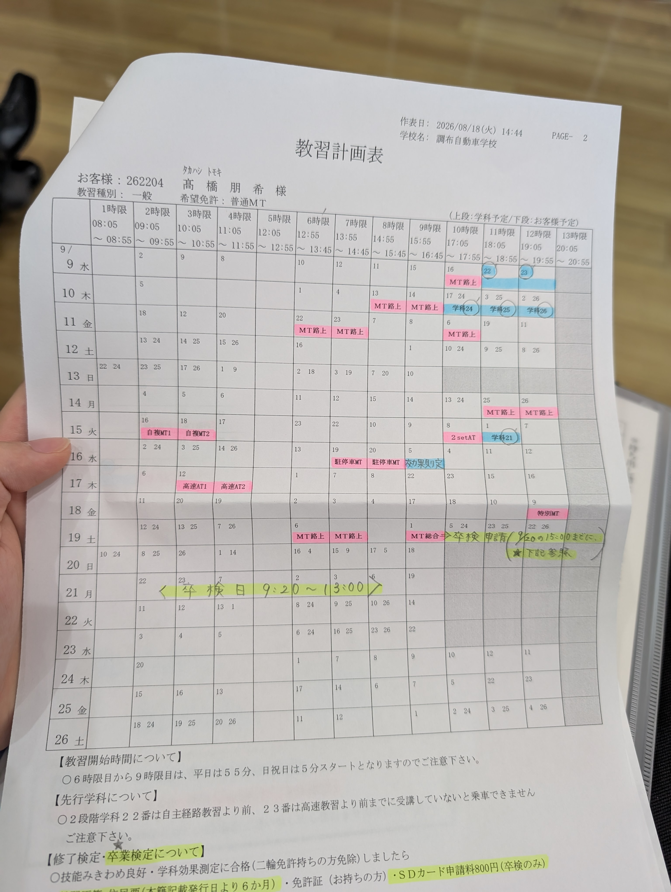
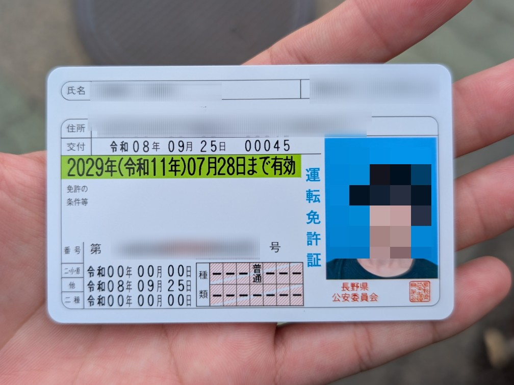

しばらく忙しかったのと、このサイトの整備全然してなくて、9月には免許取れてたのに書くのが11月になってしまった。11月？嘘だよな…

## 自動車学校のはなし

[前の記事](/blog/260906-shakou-part1)の続きだけど、まあなんだかんだあって9/21に自動車学校を卒業しました。

第二段階、初めて公道出たときはめちゃくちゃ緊張したし、自信喪失状態でした。

信号で対向が止まってから右折で発進するぞってときにエンストして超焦ったりした。

それでも無事みきわめを一発で通ってそのまま卒検合格までいきました。

### キャンセル待ち

元々教習所側が組んでくれたスケジュール通りに教習が進んでいたけど、バイトが長引いて9/18の技能教習に間に合いませんでした。

間に合わないってわかったタイミングで電話して、その日の教習をキャンセルしました。

当日キャンセルなのでキャンセル料が発生すること自体はいいけど、その後の日程大丈夫かな…と不安に思ってたら、翌日の朝に特別教習の枠が空いてるので予約できますと案内され、とりあえず予約。

その日のうちに教習所に行ってキャンセル料を支払い、その後の日程について相談しました。

ひとつ問題があって、元々翌日19日は技能教習が上限の3時間入っていたため、最後のみきわめの1時間を20日以降にする必要があり、しかも卒検の仮予約が21日で、20日の15時までにみきわめを終わらせて本予約しないといけない。

20日はその時点で空きがないので、朝からキャンセル待ちするしかないとのことでした。

ということで、19日に振り替えた分含めて3時間やり、20日の朝6時50分くらいに教習所に行きました。

教習所が開くのが7時だけど、自分が行ったときには既に列ができていて、自分で10番目でした。

キャンセル待ちは先着順なので、14時台までの枠が取れるか心配でした。

ラッキーなことに、その日は大雨でたくさんキャンセルが出たのか、1時間に3人くらいずつ呼ばれて、無事11時台の枠が取れました。

そして無事に予定通りの日程で卒業することができました。

22日から工研合宿だったからギリギリだった。

## 免許交付

住民票が長野なので、9/25に長野の試験場で学科試験を受けて合格し、ついに免許が交付されました。

眼鏡等なし、AT限定なしなので免許の条件の欄が空白で綺麗です。

ここまでのスケジュールをまとめると、

- 7/25 自動車学校申し込み
- 8/22 教習開始
- 9/4 仮免取得
- 9/21 自動車学校卒業
- 9/25 免許取得

ということで、思い立ってから2ヶ月、教習開始からおよそ1ヶ月で免許が取れました。

## その後

10月はタイムズカーで車借りてめちゃくちゃ乗ったし、レンタカー借りて帰省してみたりしました。

カードの請求がこわいぜ……

おわり
