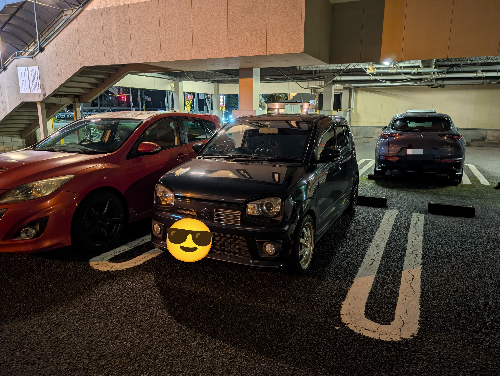
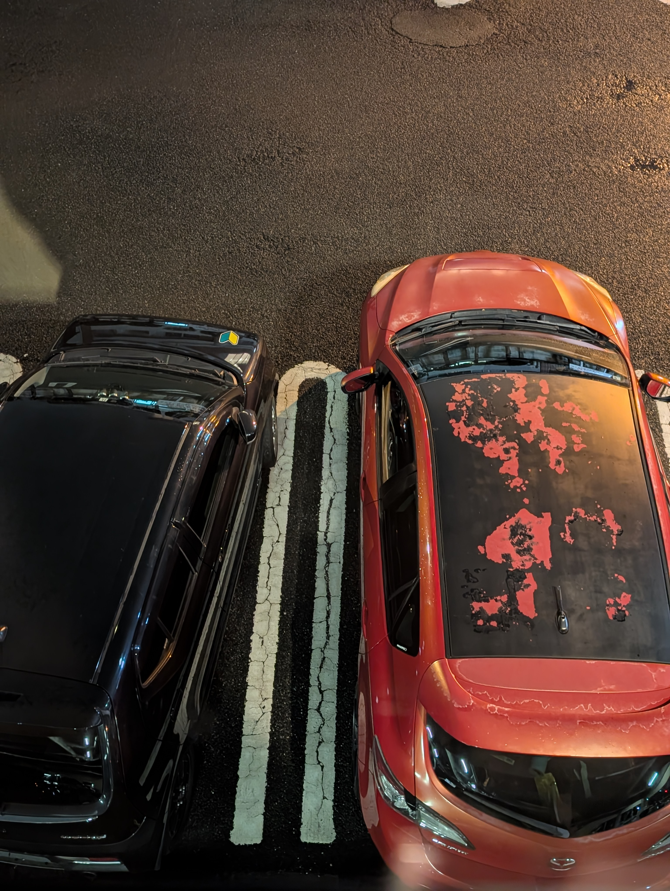

2016年式 スズキ アルトワークス HA36S

5MT 4WD ターボ

## 経緯

あまりにもすごいペースで話が進んだので自分もびっくりしてるんだけど、ついに車を買ってしまいました。

9月末にやっと免許取って、しばらくタイムズカーで車借りたりして運転してたわけですが、やっぱり自分の車が欲しくなっちゃいました。

いつもの電子工作の延長で電装とかいじりたいし、せっかくMTの免許取ったからMT車乗りたい〜ってずっと言ってたら、たまたまタイミングよくいい話が入ってきまして。

ちょうど自動車部の友達が新しく車買って、今まで乗ってた車の買い手を探していて、個人売買で安く売ってくれるということで、相場の半額以下の値段で買うことができました。

前オーナーが知り合いってのは安心感がすごいし、これを機に自分も自動車部に入部したので、これからは色々教えてもらいつつ自分で整備していきたい。

## 東京で車を持つということ

さて、東京で車を持つというのはなかなか大変である。

まあ好きじゃなきゃ普通持たないよね、駐車場高いし。

自分はちょうど今引っ越しをしていて、引っ越し先の賃貸マンションの敷地内の駐車場を1.5万で借りられたので、そこを使ってます。

調布市だと単身用の賃貸マンションで駐車場付きのところはなかなかないし、月極駐車場は最低でも1万はする、しかも安いところは機会式の地下だったりするので出し入れがめんどくさいです。

今回自分は家の前の平置きの駐車場が借りられてめちゃくちゃラッキーです。(ちょっと高くはあるけど)

ただまあ、地方では1人1台車持ってるだろうし、車にかかるお金の差は駐車場代くらいなので、この1.5万を我慢できれば大丈夫。

電車あるから車いらんって人いると思うけど、なんだかんだあるとめちゃくちゃ便利。

ホームセンターとか行ってでかい買い物しても適当に車に積んで帰れる。

## 運転上手くなりたい

とはいえまだ免許取って1ヶ月半くらいで、MT車はほとんど乗ってなかったので、全然うまく運転できない。

とくに坂道発進と車庫入れが下手くそすぎてやばい。今日もエンスト祭りでした。

なるべくいっぱい乗って上手くなりたいっすね。

↑仲良し(下手くそ)

隣のマツスピアクセラがアルトワークスの前オーナーの新しい車です。

おわり
